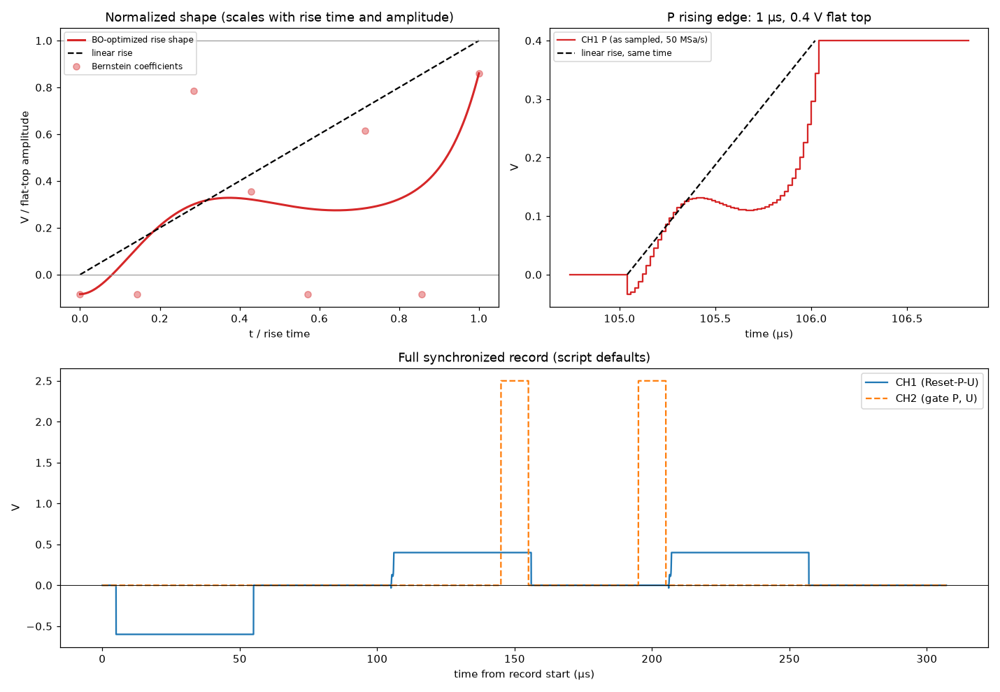

# Beamtime SSRL 2026-11-22: Reset-PU with a BO-optimized rising edge

`sdg6022x_synchronized_1rpund_2gate_BO_shaped_rise.py` drives a Siglent SDG6022X:
CH1 plays Reset-P-U and CH2 plays the two gate pulses. It is based on
`sdg6022x_synchronized_1rpund_2gate_sequence_with_init_n_end_holds_faster.py`
from [autlee17/Siglent_AWG_SGD6022X](https://github.com/autlee17/Siglent_AWG_SGD6022X).

## What changed

The **rising edge of P and U** is now the shape found by Bayesian optimization
instead of a linear ramp. Everything else is unchanged: reset, falling edges,
gaps, CH2 gates, upload and trigger code.

Only the *shape* is fixed. Rise time and amplitude are still settings:

| Setting | Meaning |
|---|---|
| `pos_rise_time_s` | duration of the BO-shaped rise (default 1 µs) |
| `pos_amplitude_v` | flat-top voltage; the shape is scaled to it |
| `pos_edge_time_s` | linear **falling** edge only |
| `BO_RISE_SHAPE` | 8 Bernstein coefficients, as fractions of the flat top |

The rise is V(t) = `pos_amplitude_v` · Σₖ cₖ·C(7,k)·sᵏ(1−s)⁷⁻ᵏ with
s = t / `pos_rise_time_s`. It is sampled exactly as in the optimization: the
built rise matches the BO code to within 3·10⁻⁸ V.

The CH2 offset now uses `pos_rise_time_s` in place of the P rise edge, so the
P gate still ends 1 µs (`gate_pad`) before the end of P's flat top.

## Where the shape comes from

The shape is the BO run of 2026-11-17 on device BTO_PLD219_2, with a 1 µs rise
and a 1.2 V flat top (`rise_time_s1e-06_rep2`). Its confirmed result was 30.4 %
less switching work (∫V·(I_P − I_U)dt over the rise) than a linear rise, at the
same switched polarization (1.0007 × the linear rise).

The shape has two features to be aware of:
- It starts at −0.083 × amplitude, a small dip below 0 V.
- It ends at 0.86 × amplitude and steps up into the flat top.

Both are part of the optimized shape.

It was optimized for that device, at 1 µs and 1.2 V. At other rise times or
amplitudes the shape is reused as is. It is not re-optimized there, so it may
not be the best shape.

## Waveform

Panels:
- **Top left:** the normalized shape against a linear rise.
- **Top right:** the P rising edge as sampled with the script defaults (50 MSa/s, 1 µs, 0.4 V).
- **Bottom:** the full CH1/CH2 record.

Verify the actual voltage at the DUT with an oscilloscope before connecting a
sensitive device.
